# SCI Scope 界面说明

适用版本：**1.3.10**。以下按界面逐项介绍控件作用。截图使用模拟数据和示例端口，不代表实机运行状态；部分截图沿用界面相同的 1.3.9 版本。

导航：[公共区域](#common) · [实时示波器](#scope) · [通用收发](#generic) · [单电机 FOC](#single) · [对拖 FOC](#dual) · [记录分析](#history) · [协议配置](#protocol) · [绘图右键菜单](#plot-menu)

## 1. 公共区域

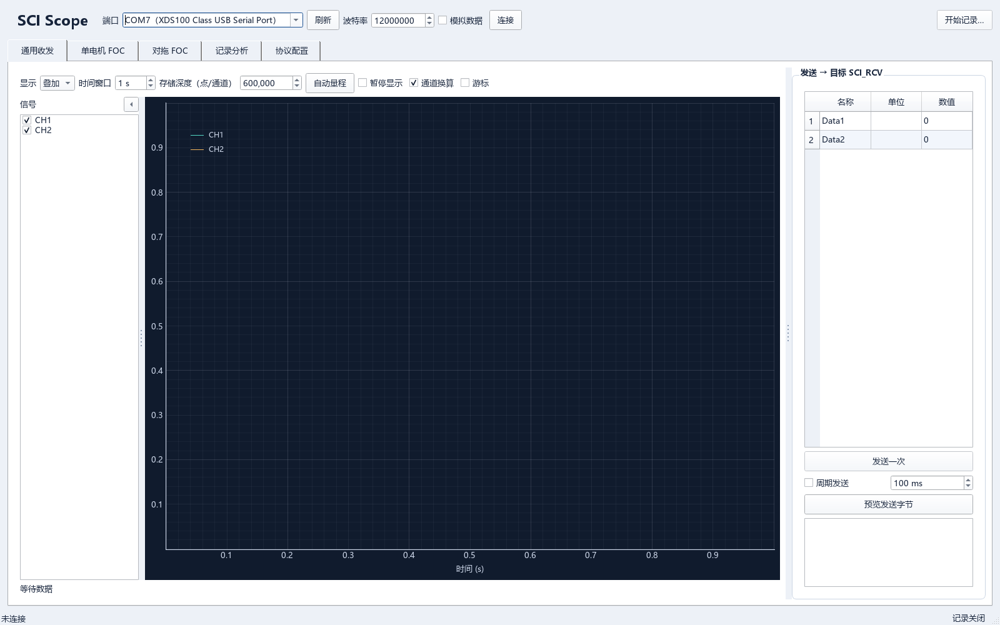

| 控件 / 区域 | 作用 |
|---|---|
| 窗口标题 | 显示当前配置名称与软件版本。 |
| 端口 | 选择串口，也可直接输入 COM 号；有设备名称时显示在括号内。启动时优先预选 XDS100 Class USB Serial 端口。 |
| 刷新 | 重新枚举串口，保留当前选择。 |
| 波特率 | 设置 PC 串口速率，单位 bit/s；应与目标一致。默认 12000000。 |
| 模拟数据 | 使用软件内置模拟源，便于查看波形和试用记录、分析功能；不打开真实串口。 |
| 连接 / 断开 | 开启或关闭采集连接。连接期间锁定串口参数、协议配置及 FOC 预设。 |
| 开始记录… / 停止记录 | 选择记录父目录并开始记录，或结束记录并完成写盘。须先连接采集源。 |
| 通用收发 | 通用数据发送与实时示波器。 |
| 单电机 FOC | 官方单电机模型的预设与控制。 |
| 对拖 FOC | 官方双电机对拖模型的预设与控制。 |
| 记录分析 | 查看已保存的记录，进行统计、FFT、导出及 MATLAB 查看。 |
| 协议配置 | 设置与目标 SCI 收发模块对应的串口参数、帧格式和字段信息。 |
| 底部左侧状态 | 显示接收吞吐率、有效帧数、重同步（帧边界恢复）次数；记录时还显示队列大小、已写入组数，周期发送时显示相应状态。 |
| 底部右侧状态 | 显示记录关闭、记录目录、写盘中、记录完成或写盘错误。 |

设备名称仅用于显示；连接及保存配置时仍使用 COM 号。连接、切换标签页均不自动发送电机启动命令。

连接后通常等待 3 秒仍无有效帧时，显示检查串口连接、波特率及协议配置的提示；这不表示已经确定波特率错误。

## 2. 实时示波器

通用收发、单电机 FOC、对拖 FOC 共用同一实时示波器；切页保留显示设置。

| 控件 / 区域 | 作用 |
|---|---|
| 显示：叠加 | 所选通道显示在同一幅图中。 |
| 显示：分图 | 每个所选通道单独绘图，各图时间轴联动。 |
| 时间窗口 | 设置一次显示的时间跨度，单位 s；实时状态下始终显示最新数据。 |
| 存储深度（点/通道） | 设置每路实时缓存的点数，类似示波器存储深度；默认每路 600000 点。可在连接期间调整，不影响记录。 |
| 存储深度悬停提示 | 显示该点数对应的缓存时长和原始缓存内存。20 kHz 下，600000 点对应 30 秒。 |
| 自动量程 | 对各图的 **Y 轴**启用自动量程，不修改时间窗口。 |
| 暂停显示 | 冻结当前缓存快照，可缩放查看；采集和记录继续。取消勾选后回到最新数据。 |
| 通道换算 | 开启时应用接收通道的比例、偏移和单位；关闭时显示解码值。定点与符号解码仍生效。 |
| 游标 | 开关两条可拖动的时间游标 A、B；默认关闭。 |
| 左侧通道复选框 | 控制对应曲线的显示 / 隐藏，不改变接收和记录的通道数。 |
| 信号栏左箭头 / 右箭头 | 折叠 / 展开信号选择栏，展开时恢复原宽度。 |
| 竖向点状分隔条 | 拖动调整信号栏或右侧控制栏宽度。单电机与对拖页共用控制侧栏宽度。 |
| 图例 | 用名称、单位和颜色对应各条曲线。 |
| 横轴 / 纵轴 | 横轴为按采样率重建的段内时间；纵轴为对应通道的数值。 |
| 鼠标滚轮 / 拖动 | 滚轮缩放；默认左键拖动平移，右键拖动缩放，右键单击打开绘图菜单。查看旧数据时先暂停显示。 |
| 图角落的 A 按钮 | 对当前图执行自动范围调整；实时状态下时间轴仍随最新窗口更新。 |
| 图下方数值 | 显示所选通道最后一个显示样本的数值。 |
| 暂停后的缓存读数 | 显示当前快照可查看的时间范围和点数。 |
| 游标读数 | 显示 A、B 时间及 Δt；Δy 对应第一个勾选通道。游标越出缓存或落在无效样本上时显示“—”。 |

存储深度是**绘图参数，不是协议参数**；它独立保存，不随协议 JSON 保存。曲线采用峰值抽稀，记录保留原始采样。

查看分图、暂停与游标示例

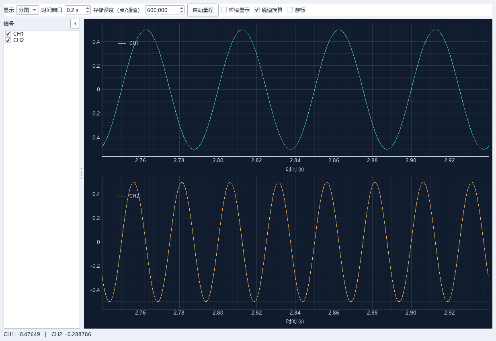

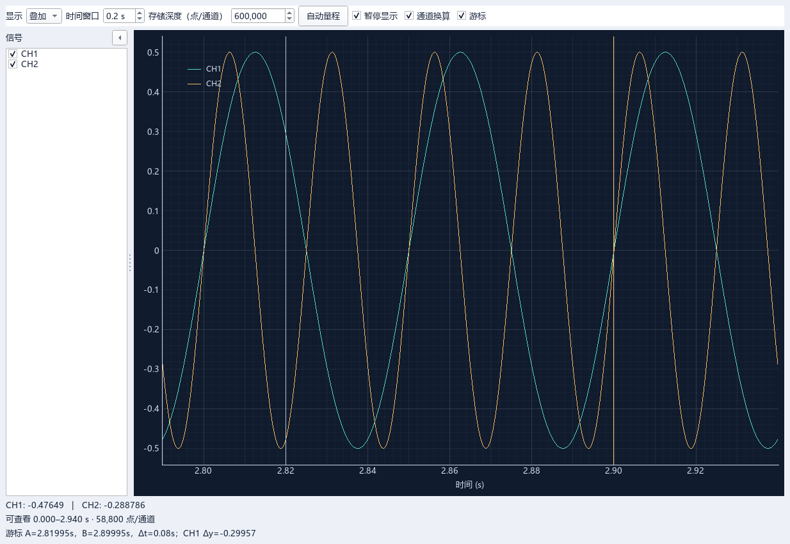

灰色竖线为 A，橙色竖线为 B；它们是测量游标。分图时游标显示在第一幅图。

## 3. 通用收发

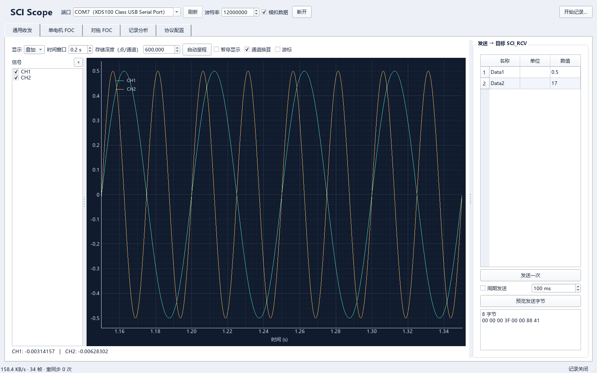

| 控件 | 作用 |
|---|---|
| 名称、单位列 | 显示协议配置中的发送字段信息，为只读列。 |
| 数值列 | 填写各发送元素的数值，按表格行顺序组成载荷。 |
| 发送一次 | 编码并下发当前数值；须已连接。 |
| 周期发送 | 按设置间隔持续发送当前表格数值；取消勾选或断开后停止。 |
| 周期间隔 | 设置周期发送间隔，单位 ms，范围 10–60000。 |
| 预览发送字节 | 检查输入并显示完整发送帧的字节数及十六进制内容，不实际下发。 |
| 下方字节框 | 显示预览或最后发送的字节；“已发送”表示主机已写出，不是目标确认。 |

类型、数量、帧头帧尾及换算来自“协议配置”。通用发送不解释电机控制字；周期发送开启后，后续发送会采用新编辑的数值。

## 4. 单电机 FOC

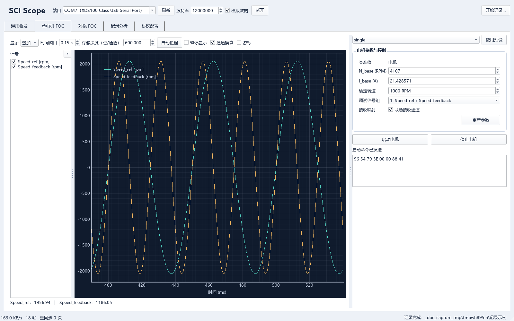

| 控件 | 作用 |
|---|---|
| single / Q28 | 选择浮点或定点预设；Q28 使用 uint32 承载定点位流。 |
| 使用预设 | 应用该官方模型的串口参数、收发格式及默认映射，保留当前 COM 号；须先断开。 |
| N_base (RPM) | 主机进行转速与标幺值换算的基准转速。 |
| I_base (A) | 主机显示电流时采用的基准电流。 |
| 给定转速 | 填写目标转速，单位 RPM。 |
| 调试信号组 | 选择目标上报的两路信号：1 转速参考/反馈；2 Id 参考/反馈；3 Iq 参考/反馈；4 Ia/Ib；5 Ia/Position。 |
| 联动接收通道 | 显式发送控制命令时，按调试组更新两路接收通道的名称、单位及换算。扩展自定义通道时关闭此项。 |
| 更新参数 | 下发当前设置，沿用本次连接中上次下发的启停状态；新连接按停机状态处理。 |
| 启动电机 | 下发带使能的当前给定与调试组。 |
| 停止电机 | 下发取消使能的命令。 |
| 命令状态、字节框 | 显示未发送、已排队、已发送及对应十六进制报文。 |

**编辑参数不会自动下发**。基准值只用于主机换算，不修改目标控制器参数。无连接或帧格式不兼容时，控制按钮禁用。

断开 / 退出不会下发停止命令；需要停机时先点“停止电机”。使用 FOC 控制会关闭通用周期发送。

## 5. 对拖 FOC

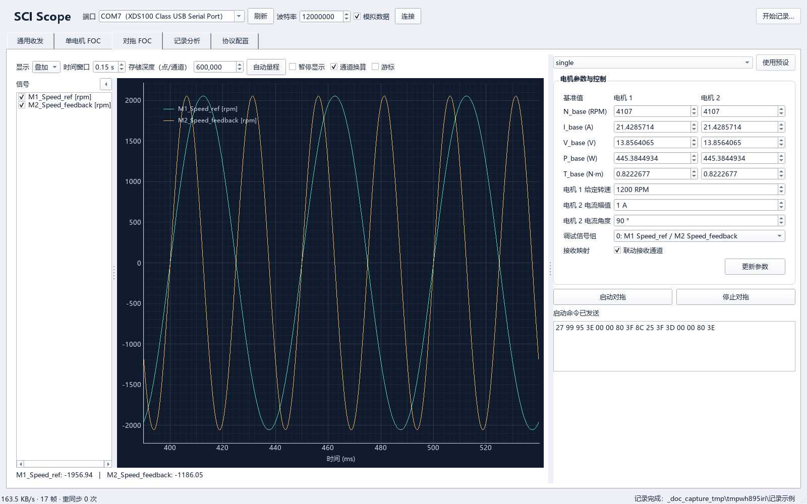

| 控件 | 作用 |
|---|---|
| single / Q28、使用预设 | 选择并应用官方对拖模型的浮点 / 定点预设；保留 COM 号，须先断开。 |
| 电机 1 / 电机 2 基准列 | 分别设置两台电机的主机换算基准。 |
| N_base (RPM) | 转速基准。 |
| I_base (A) | 电流基准。 |
| V_base (V) | 电压基准。 |
| P_base (W) | 功率基准。 |
| T_base (N·m) | 转矩基准。 |
| 电机 1 给定转速 | 设置电机 1 的转速参考，单位 RPM。 |
| 电机 2 电流幅值 | 设置电机 2 的电流参考幅值，单位 A。 |
| 电机 2 电流角度 | 设置电流参考矢量角度，单位 °。 |
| 调试信号组 | 选择编号 0–15 的两路信号组合。M1 / M2 分别表示电机 1 / 2；组 0 为 M1 转速参考与 M2 转速反馈。 |
| 联动接收通道 | 显式发送时更新官方两路调试信号的名称、单位和换算；自定义扩展通道时关闭。 |
| 更新参数 | 下发当前给定与调试组，沿用主机上次下发的启停状态。 |
| 启动对拖 / 停止对拖 | 分别下发使能 / 取消使能命令。 |
| 命令状态、字节框 | 显示命令发送状态及十六进制报文。 |

基准值来自目标的电机初始化参数，仅用于主机换算。编辑不自动发送；断开 / 退出不发送停止命令。控制按钮禁用时，检查连接与发送格式是否匹配。

## 6. 记录分析

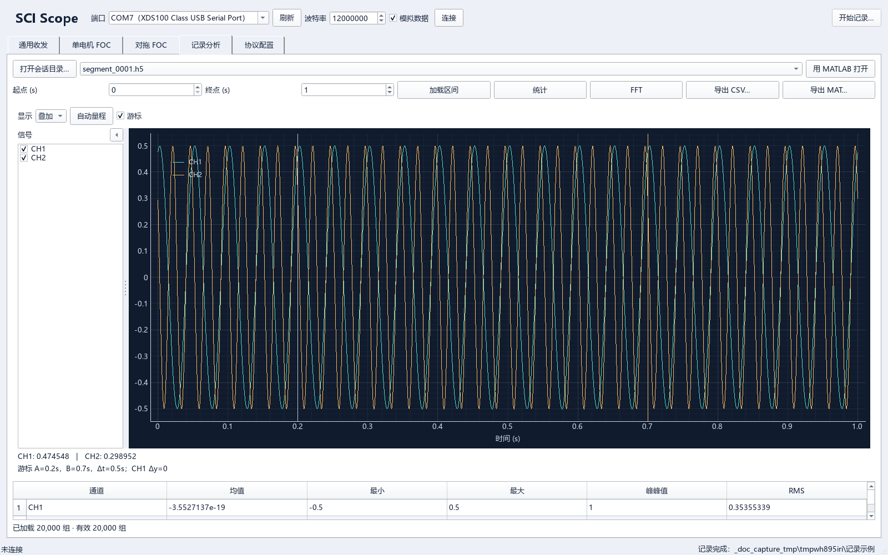

| 控件 / 区域 | 作用 |
|---|---|
| 打开会话目录… | 打开已停止记录的会话目录，列出其中的记录段。 |
| 记录段下拉框 | 切换 HDF5 记录段；每段时间独立从 0 开始。切换后自动加载前 1 秒或整段较短数据。 |
| 用 MATLAB 打开 | 将当前段、起止区间及勾选通道交给 MATLAB 查看。安装 Simulink 时使用 SDI，否则使用普通绘图窗口。 |
| 起点 (s)、终点 (s) | 指定要查看、分析或导出的段内时间区间。 |
| 加载区间 | 将起止区间读入历史示波器；修改区间后，统计 / FFT 前须重新加载。 |
| 统计 | 计算已加载区间**所有通道**的均值、最小、最大、峰峰值和 RMS，显示下方统计表。 |
| FFT | 对已加载的连续有效数据计算去均值、Hann 窗的单边幅值谱，绘制勾选通道。 |
| 导出 CSV… | 导出当前起止区间的勾选通道，附带时间、段编号、有效标志和元数据文件。 |
| 导出 MAT… | 导出时间、数据、有效标志、采样率、名称、单位及配置；大数据自动拆分文件。 |
| 显示：叠加 / 分图 | 将勾选通道叠加或分别绘图。 |
| 自动量程 | 对历史波形的 Y 轴启用自动量程。 |
| 游标 | 开关 A/B 时间游标及 Δt、首个勾选通道的 Δy。 |
| 左侧通道复选框 | 选择绘图、FFT 显示、导出和 MATLAB 打开的通道；不限制“统计”计算的通道。 |
| 左右箭头、点状分隔条 | 折叠 / 展开信号栏及调整其宽度。 |
| 波形下方数值 | 显示已加载区间末尾样本的数值。 |
| 统计表 | 按通道显示各统计量，可滚动查看其他行；重新加载区间或切换段时清除旧结果。 |
| 底部消息 | 显示组数、段长、正常关闭 / 不完整、加载结果、后台进度及导出 / MATLAB 结果。 |

历史数据按**录制时的通道配置**换算。导出及 MATLAB 打开直接使用起止区间，无需先“加载区间”；查看 / MATLAB 单次区间有 128 MiB 预算限制。

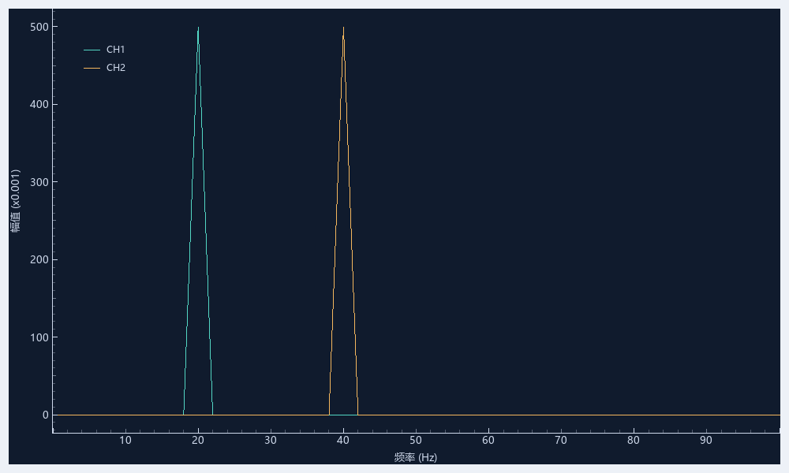

FFT 横轴为频率，纵轴为幅值，单位和倍率以轴标注为准；鼠标操作与波形图相同。关闭该窗口不关闭主程序。

## 7. 协议配置

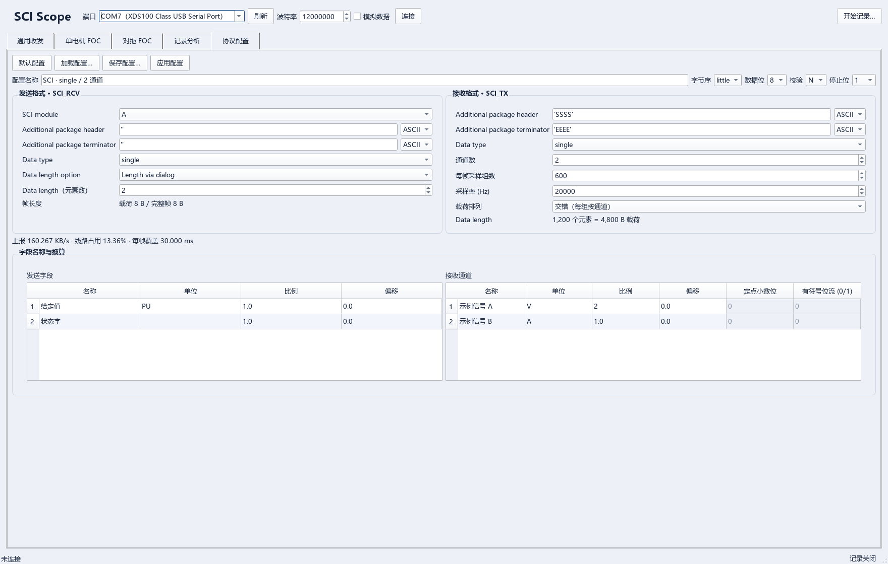

连接期间本页禁用。参数须对应目标 SCI 收发模块；修改上位机配置不会修改目标程序。

### 7.1 顶部按钮与串口参数

| 控件 | 作用 |
|---|---|
| 默认配置 | 恢复通用默认配置，保留当前 COM 号。 |
| 加载配置… | 从 JSON 读取协议及可选 FOC 设置。 |
| 保存配置… | 将当前设置保存为 JSON；不启动连接或下发命令。 |
| 应用配置 | 校验当前表单，更新字段、示波器及带宽显示。 |
| 配置名称 | 设置配置的显示名称，不影响发送字节。 |
| 字节序 | little 为小端，big 为大端；同时用于发送和接收，须与目标一致。 |
| 数据位 | 选择 5 / 6 / 7 / 8 位串口数据位。 |
| 校验 | N 无校验、E 偶校验、O 奇校验、M Mark、S Space。 |
| 停止位 | 选择 1 / 1.5 / 2 位停止位。 |

### 7.2 发送格式 · SCI_RCV

| 控件 | 作用 |
|---|---|
| SCI module | 记录目标模块 A / B / C / D 的标识；PC 串口仍在顶部选择。 |
| Additional package header | 设置 PC 下发帧头；空值表示没有帧头。 |
| Additional package terminator | 设置 PC 下发帧尾；空值表示没有帧尾。 |
| 帧头 / 帧尾旁的 ASCII、HEX | 选择标记输入方式。ASCII 示例：`''`、`'SS'`、`[83 83]`；HEX 示例：`53 53`。 |
| Data type | 设置整帧载荷的统一数据类型。 |
| Data length option | 当前仅支持 Length via dialog；输入端口长度和可变长度两项未支持。 |
| Data length（元素数） | 设置一帧下发多少个数据元素，自动生成相同数量的发送字段。不是字节数。 |
| 帧长度 | 自动显示载荷字节数和含帧头帧尾的完整帧字节数。 |

### 7.3 接收格式 · SCI_TX

| 控件 | 作用 |
|---|---|
| Additional package header | 设置目标上报帧头。 |
| Additional package terminator | 设置目标上报帧尾。 |
| 帧头 / 帧尾旁的 ASCII、HEX | 选择标记输入方式，与发送区相同。 |
| Data type | 设置上报载荷元素的数据类型。 |
| 通道数 | 将目标载荷拆为多少路信号；增加后需同步修改目标 SCI_TX 的发送数量。 |
| 每帧采样组数 | 一帧中每路的采样点数；600 组表示每个通道各有 600 点。 |
| 采样率 (Hz) | 每通道的目标采样率，用于时间轴、FFT 和带宽计算；不改变目标采样率。 |
| 载荷排列：交错 | 每组按通道排列：CH1、CH2、…，然后下一组。 |
| 载荷排列：分通道 | 先连续排列 CH1 的全部点，再排列 CH2，依此类推。 |
| Data length | 自动显示“通道数 × 每帧组数”的元素总数及载荷字节数。 |
| 带宽读数 | 显示上报字节率、线路占用和每帧覆盖时间。占用超过 80% 提示余量不足，超过理论容量拒绝配置。 |

Data type 可选 `single`（32 位浮点）及 `int8 / uint8 / int16 / uint16 / int32 / uint32`（相应位数的有符号 / 无符号整数）。

### 7.4 字段名称与换算

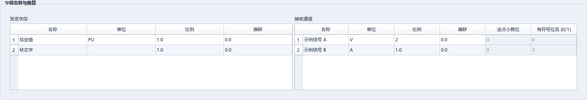

该区域始终展开；双击表格单元格编辑。**接收信号命名入口在右侧“接收通道”的“名称”列。**

| 列 / 控件 | 作用 |
|---|---|
| 发送字段：名称、单位 | 设置通用发送面板各行的名称和单位，不增加报文字段。 |
| 发送字段：比例、偏移 | 发送前换算：编码值 =（输入值 − 偏移）/ 比例；比例不能为 0。 |
| 接收通道：名称、单位 | 设置通道列表、图例及历史 / 导出中的信号名称和单位。 |
| 接收通道：比例、偏移 | 显示值 = 解码值 × 比例 + 偏移；默认 1、0。 |
| 接收通道：定点小数位 | 整数解码后除以 2 的该次幂；普通整数填 0，Q28 填 28。single 时禁用并归零。 |
| 接收通道：有符号位流 (0/1) | 仅无符号整数可配置：1 按同位宽有符号数解释，0 保持无符号解释。single 和有符号整数时禁用并归零。 |

FOC 的“联动接收通道”开启时，显式发送 FOC 命令可覆盖对应名称和换算；保留自定义扩展通道时关闭联动。

## 8. 绘图右键菜单

这是绘图库自带的辅助控件；日常显示可直接使用中文示波器工具栏。

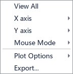

| 项目 | 作用 |
|---|---|
| View All | 自动调整当前图的 X / Y 范围以容纳曲线。 |
| X axis / Y axis | 手工范围、自动范围、坐标反向及鼠标控制等轴设置。 |
| Mouse Mode → 3 button | 左键平移、右键拖动缩放，默认模式。 |
| Mouse Mode → 1 button | 左键框选区域放大。 |
| Plot Options | 绘图变换、抽稀、透明度、网格等辅助设置。 |
| Export… | 打开绘图导出窗口，导出图像或绘图对象中的数据。 |

轴设置、Plot Options 及绘图导出的控件

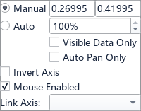

| 轴设置 | 作用 |
|---|---|
| Manual、两个范围输入框 | 使用手工最小 / 最大范围。 |
| Auto、百分比 | 自动计算范围；百分比表示纳入范围计算的数据比例。 |
| Invert Axis | 反转坐标方向。 |
| Mouse Enabled | 开关该轴的鼠标缩放 / 平移。 |
| Visible Data Only | 自动范围只参考另一轴当前可见区域的数据。 |
| Auto Pan Only | 自动平移范围，保持跨度。 |
| Link Axis | 链接其他已命名视图；本软件通常没有可选命名视图，分图时间联动已由软件处理。 |

| Plot Options 项目 | 作用 |
|---|---|
| Transforms → Power Spectrum (FFT) | 对当前绘图数据做绘图库的频谱变换。原始记录分析使用“记录分析”的 FFT 按钮。 |
| Transforms → Subtract Mean | 绘图时去均值。 |
| Transforms → Log X / Log Y | 将相应轴改为对数显示。 |
| Transforms → dy/dx | 绘制数值导数。 |
| Transforms → Y vs. Y' | 绘制数值与其导数的关系图。 |
| Downsample、倍数、Auto | 启用并设置绘图库的额外抽稀或自动抽稀。 |
| Subsample / Mean / Peak | 分别采用抽点、均值、峰值抽稀。 |
| Clip to View | 裁剪至可见范围。 |
| Average、参数列表 | 对匹配参数的曲线求平均；本软件没有多次运行曲线叠积功能，通常不使用。 |
| Alpha、Opacity、Auto | 开关 / 调整曲线透明度，或自动设置透明度。 |
| Grid → Show X Grid / Show Y Grid、滑块 | 开关相应网格并调整透明度。 |
| Downsample → Max Traces、数量 | 限制绘图库显示的曲线数。 |
| Downsample → Forget hidden traces | 从绘图对象移除被该曲线数限制隐藏的曲线。 |
| Points、Auto | 绘图库保留的点显示选项；当前软件未接入点样式控制。 |

这些设置作用于当前图，重建图形时可能恢复默认；额外变换可能改变绘图读数的解释，底部样本 / 游标读数仍基于软件缓存值。

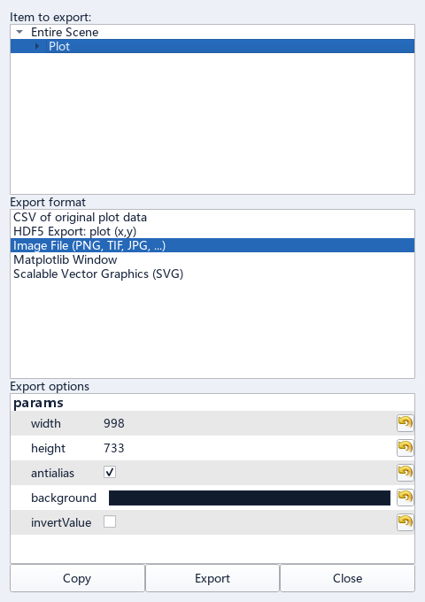

| 控件 | 作用 |
|---|---|
| Item to export | 选择整张绘图场景（Entire Scene）、某幅图（Plot）或视图区（ViewBox）。 |
| Export format | 选择 PNG 等位图、SVG 矢量图、CSV、HDF5 或 Matplotlib 图窗；Matplotlib 图窗需要额外依赖。 |
| Export options | 设置所选格式的参数。位图的 width / height 为像素尺寸，antialias 为抗锯齿，background 为背景色，invertValue 反转颜色明暗。 |
| SVG 的 scaling stroke | 决定线宽是否随缩放变化；width / height、background 控制尺寸和背景。 |
| CSV 的 separator / precision / columnMode | 分隔符、数值精度及列排列方式。 |
| HDF5 的 Name / columnMode | 输出数据集名称及列排列方式。 |
| Export | 保存为所选格式的文件。 |
| Copy | 将支持复制的图像 / SVG 复制到剪贴板。 |
| Close | 关闭导出窗口。 |

右键 CSV / HDF5 导出的是**绘图对象的数据，可能已抽稀**。要导出记录中未抽稀的采样，使用“记录分析”页的“导出 CSV… / 导出 MAT…”。

