# SCI Scope 快速上手

开始前，完成目标模型所需的 MATLAB 硬件开发环境配置，连接开发板、电机及驱动板。以下示例使用 `single` 数据类型；串口号和电机基准值以本机、实际目标程序为准。

## 1. 官方单电机模型连接

配套视频：`1_官方单电机模型连接演示`。

### 准备目标程序

在 MATLAB 中打开官方示例：

```matlab
openExample("mcb/SimscapeElectricalExample")
```

1. 检查 `mcb_ee_pmsm_foc_data.m`，确认电机、驱动板参数及 `dataType` 与实际配置一致。记录 `PU_System.N_base` 和 `PU_System.I_base`，后续用于上位机换算。
2. 打开目标模型 `mcb_ee_pmsm_foc.slx`，连接 F28379D 开发板。
3. 在 **HARDWARE → 编译、部署和启动** 中生成并烧录程序，等待日志确认编译、部署成功。

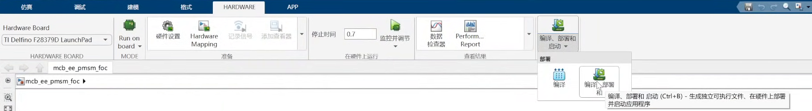

### 连接与操作

1. 打开 SCI Scope，进入“单电机 FOC”，选择 `single`，点击“使用预设”。若目标实际使用 Q28 位流收发，则使用对应的 Q28 预设。
2. 选择开发板串口，设置与目标一致的波特率，点击“连接”。
3. 将 `N_base`、`I_base` 填为目标脚本中的基准值，设置给定转速和调试信号组，点击“更新参数”。本例采用 **2000 RPM**、**组 1：Speed_ref / Speed_feedback**。
4. 开启“联动接收通道”后，上位机会根据选择的调试信号组自动更新接收信号的名称和对应的换算规则。
5. 点击“启动电机”，观察参考转速和反馈转速；稳定后，反馈应在给定转速附近。
6. 结束时先点击“停止电机”，再断开连接。需要查看刚才的波形，可勾选“暂停显示”，随后缩放或开启游标。

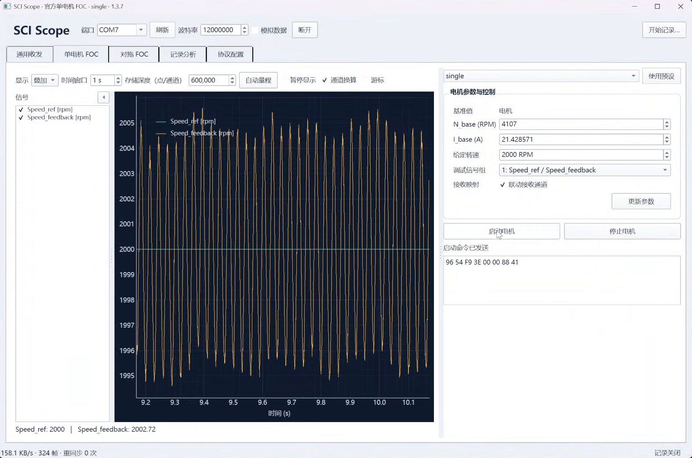

串口不确定时，在 Windows“设备管理器 → 端口（COM 和 LPT）”查找 **XDS100 Class USB Serial Port** 对应的端口号。截图中的 `COM7` 仅为示例。

编辑参数不会自动发送，运行中调整给定值或调试组也需点击“更新参数”。“暂停显示”只冻结波形，采集和记录继续；**断开连接或关闭软件不会自动停止电机**。

## 2. 官方对拖模型连接

配套视频：`2_官方对拖模型连接演示`。

### 准备目标程序

```matlab
openExample("mcb/DualMotorDynoExample")
```

1. 检查 `mcb_pmsm_foc_dyno_f28379d_data.m`，确认两台电机和驱动板参数。
2. 记录 `PU_System_motor1`、`PU_System_motor2` 中的 `N_base`、`I_base`、`V_base`、`P_base`、`T_base`。
3. 打开目标模型 `mcb_pmsm_foc_f28379d_dyno.slx`，按第 1 部分的方法编译、部署和启动，确认日志无错误。

### 连接与操作

1. 进入“对拖 FOC”，选择 `single`，点击“使用预设”，然后选择正确串口和波特率并连接。
2. 在“电机 1”“电机 2”两列分别填写目标脚本中的基准值(预设值是脚本的默认值)。
3. 电机 1 使用速度环，电机 2 使用电流(力矩)环。设置电机 1 给定转速、电机 2 (力矩)电流幅值，不建议修改电流角度(保持垂直于d轴)。本例采用 **1200 RPM、1 A、90°**，调试组为 **组 0：M1 Speed_ref / M2 Speed_feedback**。
4. 点击“更新参数”，再点击“启动对拖”，观察所选两路数据。运行中切换调试组或修改给定值后，再点击“更新参数”。
5. 点击“停止对拖”结束运行，再断开连接。

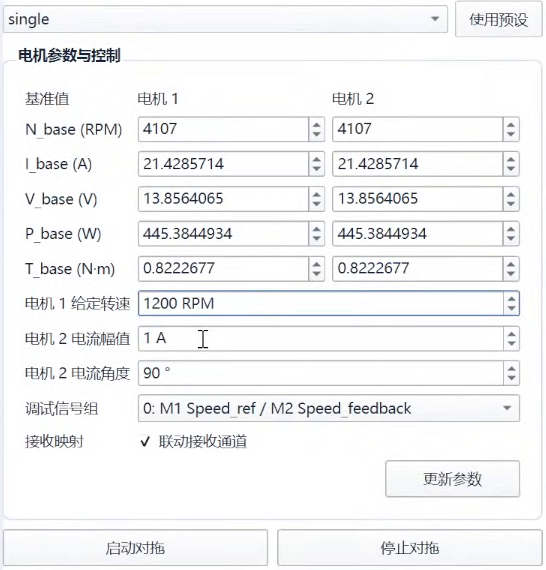

“联动接收通道”开启时，上位机会按已发送的调试组设置两路通道名称和换算。基准值只用于上位机换算，不会修改目标控制器参数。

## 3. 扩展上报数据：同时接收 4 通道

配套视频：`3_拓展上报数据演示`。

### 修改目标模型

官方模型默认从调试信号中选择两路上传。本例改为固定上传四路，输入 `SCI_Tx` 的向量顺序为：

```text
[转速参考, 转速反馈, Ia, Ib]
```

1. 进入单电机模型的 `Current Control → Debug_signals`，移除原先的两路选择逻辑。
2. 按上述顺序将四路信号组合为向量，连接到 `SCI_Tx`。向量中第 1～4 个元素分别对应上位机的第 1～4 通道。
3. 确认上传缓冲和发送长度与四路输入一致，重新编译、部署和启动。

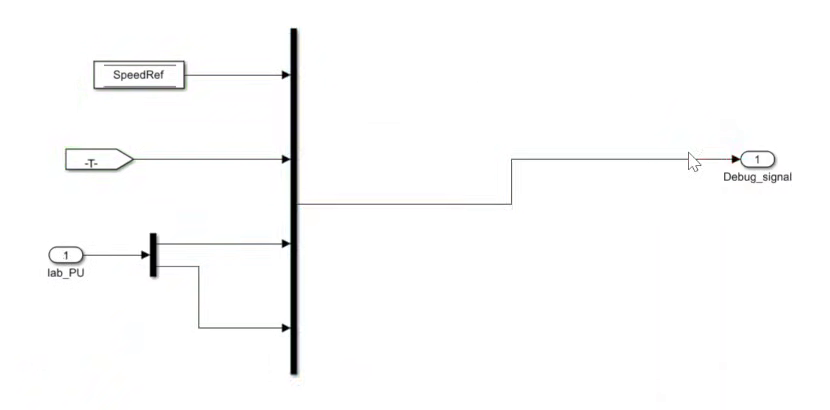

### 配置上位机

断开串口后，进入“协议配置”，在 **接收格式 · SCI_TX** 中设置：

| 项目 | 本例设置 |
| --- | --- |
| 帧头 / 帧尾 | ASCII 模式下填写 `'SSSS'` / `'EEEE'` |
| Data type | `single` |
| 通道数 | `4` |
| 每帧采样组数 | `600` |
| 采样率 | `20000 Hz` |
| 载荷排列 | 交错（每组按通道） |

**600 组表示每路各有 600 点**，此时一帧共 `4 × 600 = 2400` 个 `single` 元素，载荷为 9600 字节。通道数增加后，帧长度也随之增加。

在“字段名称与换算 → 接收通道”中，按目标向量顺序设置名称、单位和换算参数：

| 通道 | 名称示例 | 单位 | 比例 | 偏移 |
| --- | --- | --- | --- | --- |
| 1 | SpeedRef | rpm | `PU_System.N_base` 的数值 | 0 |
| 2 | SpeedFeedback | rpm | `PU_System.N_base` 的数值 | 0 |
| 3 | Ia | A | `PU_System.I_base` 的数值 | 0 |
| 4 | Ib | A | `PU_System.I_base` 的数值 | 0 |

表格中填写的是基准值的**数值**，不是 MATLAB 表达式。单位只用于显示和记录，换算由比例与偏移完成：`显示值 = 原始标幺值 × 比例 + 偏移`。例如 `N_base = 4107` 时，转速通道比例填 `4107`。若希望显示原始 PU 值，比例保持 `1`、偏移保持 `0`。

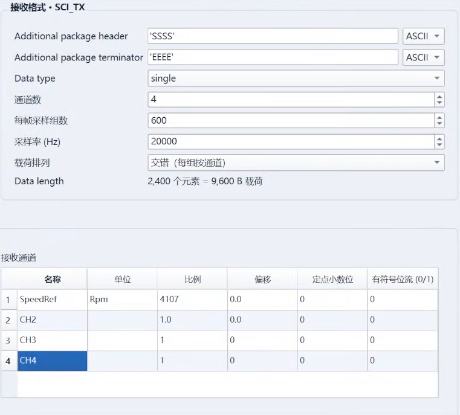

### 运行与检查

1. 可先“保存配置”，再点击“应用配置”，选择串口并连接。
2. 本例没有修改下发格式，仍可使用“单电机 FOC”启停电机；**关闭“联动接收通道”**，保留自定义通道配置。
3. 选择“分图”可分别查看转速和电流。下图仅换算了第 1 路，其余三路仍显示原始标幺值。

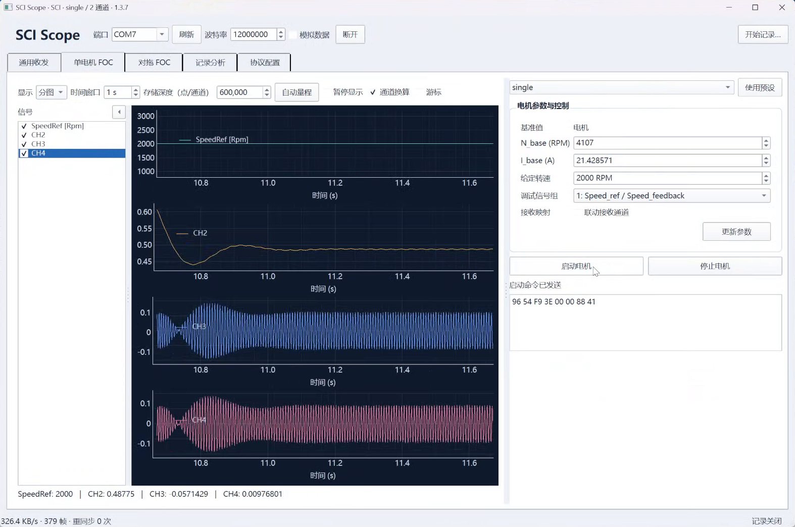

不要在此时重新点击“使用预设”，该操作会恢复官方两通道接收配置。修改接收配置不会改变目标端实际上传数量，两端必须一致。

在使用官方mcb模型的默认配置下(默认single数据类型和20000Hz采样率)，由于串口通信带宽限制，建议同时发送的浮点数据通道数不要超过7个(实测8通道时偶发帧同步计数，详细可见本文档第6部分)

## 4. 扩展下发数据：发送 3 个字段

配套视频：`4_拓展下发数据演示`。

### 修改目标模型

本例将官方两个下发(开发板接收)元素扩展为三个：

```text
[目标转速 1（PU）, 电机控制字, 目标转速 2（PU）]
```

1. 展开 `Serial Receive → SCI_Rx` 的 **Code Generation** 分支，打开与当前数据类型对应的 SCI Receive 块。本例使用 `Data_Type_Float` 中的 `single` 接收块。
2. 保持 `Data length option = Length via dialog`，将 **Data length 改为 3**，点击应用。确认修改的是代码生成使用的分支。

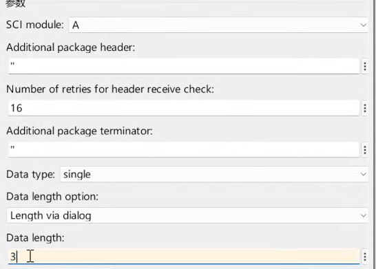

3. 在 `Data_Conditioning_Rx` 的对应数据类型分支中，将 Demux 改为三个输出。第 2 项保留原控制字处理，第 1、3 项相加后送至转速给定。
4. 重新编译、部署和启动，确认更新后的信号维度为 3。此时目标的转速给定为 `Data1 + Data3`。

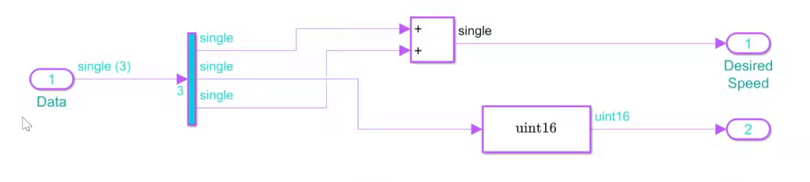

### 配置上位机

1. 断开串口，在“协议配置 → **发送格式 · SCI_RCV**”中设置 `single`、`Length via dialog`、**Data length = 3**。帧头、帧尾和字节序与目标保持一致；本例无帧头帧尾，使用小端。
2. 在“字段名称与换算 → 发送字段”中，按目标向量顺序命名三行。本例直接输入标幺值，各行比例保持 `1`、偏移保持 `0`。
3. 点击“应用配置”，可保存该配置供下次使用。此时载荷为 `3 × 4 = 12` 字节，接收格式仍保持目标原来的两通道上传配置。

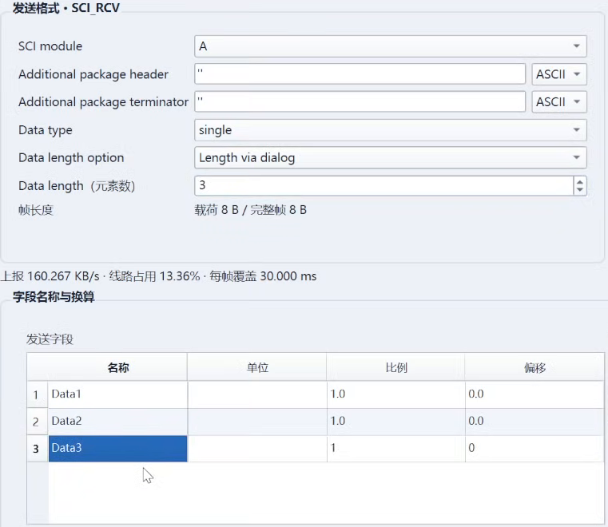

扩展下发后，使用“**通用收发**”页面。官方单电机控制页只适配原来的两个下发元素，不能发送本例的三元素命令。

### 发送与验证

连接串口后，按表格填写三个数值。可先点击“预览发送字节”检查报文，再点击“发送一次”：

| 操作 | Data1 | Data2 | Data3 | 预期结果 |
| --- | --- | --- | --- | --- |
| 第一次发送 | 0.2 | 1 | 0 | 反馈转速接近 0.2 PU |
| 将 Data3 改为 0.3，再发送 | 0.2 | 1 | 0.3 | 反馈转速接近 0.5 PU |
| 结束实验，再发送 | 0.2 | 0 | 0.3 | 取消电机使能 |

本例控制字使用 `1` 使能、`0` 停止；自定义模型应按目标程序的控制字定义填写。`0.5 PU` 对应实际转速为 `0.5 × N_base`；若接收通道已配置转速换算，图上显示的是对应的 RPM 值。

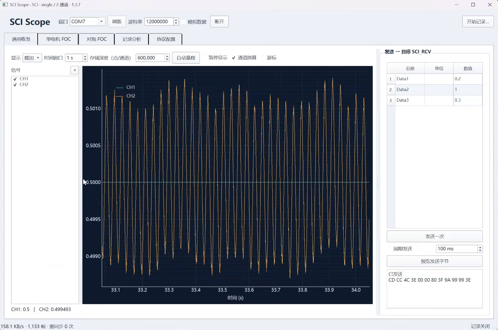

若开启“周期发送”，先关闭周期发送，再下发停止命令。连接后无有效数据或重同步持续增加时，核对串口、波特率、帧格式以及两端的数据数量。

## 5. 数据记录与查看

配套视频：`5_数据记录与查看演示`。

### 开始与结束记录

1. 选择串口并连接，确认示波器已收到数据。
2. 点击右上角“**开始记录…**”，选择保存记录的文件夹。软件会在其中新建 `session_日期_时间…` 子目录，保存本次会话。
3. 可查看底部的“记录队列”和“已写 … 组”：已写组数持续增加，说明数据正在写入；右侧显示本次会话路径。
4. 点击“**停止记录**”，等待底部显示“记录完成”，再打开记录或断开串口。

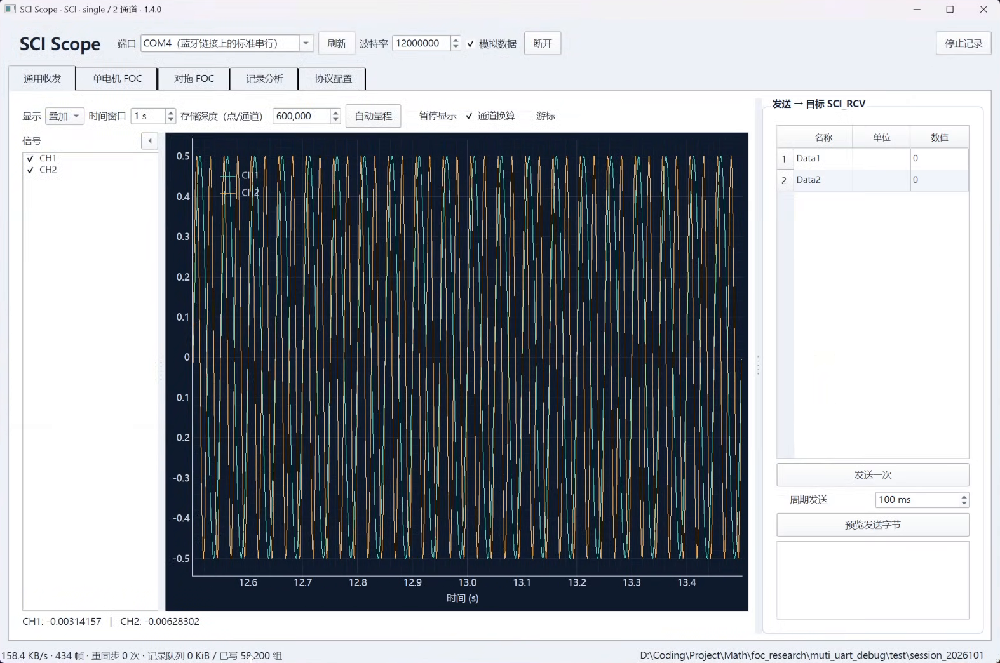

实时示波器的存储深度只影响绘图缓存；暂停显示时仍会继续记录。记录保存接收的原始采样，不受绘图抽稀影响。实机实验结束时，还需下发电机停止命令；停止记录或断开串口不会停止电机。

### 查看记录与分析

1. 进入“**记录分析**”，点击“打开会话目录…”，选择刚才生成的 **`session_…` 子目录**。该目录内应有 `segment_0001.h5` 等记录文件。
2. 在顶部下拉框中选择要查看的记录文件，填写“起点 (s)”和“终点 (s)”，点击“**加载区间**”。时间以当前记录文件的起点为零；本例查看 `0～5 s`。
3. 在左侧勾选信号，通过“叠加 / 分图”、缩放和“自动量程”调整显示。勾选“游标”后，可拖动双游标测量时间差和幅值差。
4. 点击“**统计**”，查看加载区间内各通道的均值、最小值、最大值、峰峰值和 RMS（有效值）。修改起止时间后，需重新加载区间再进行统计或 FFT。

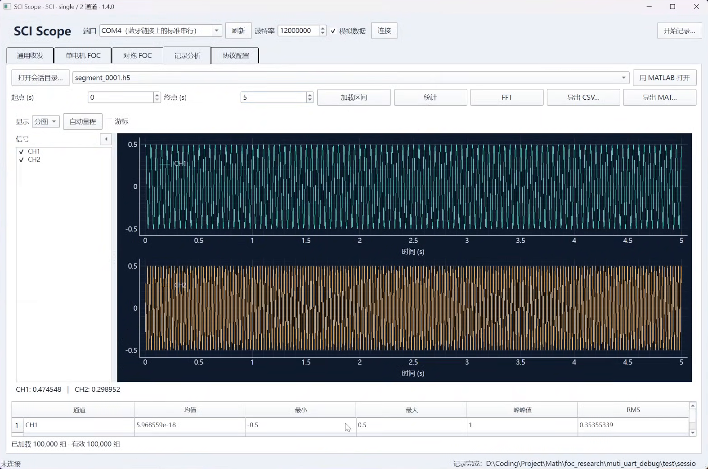

点击“**FFT**”可查看已勾选通道的单边幅值谱，默认去均值并使用 Hann 窗。可缩放频率轴查看峰值；若提示区间包含无效或过渡数据，选择连续有效的区间后重新加载。

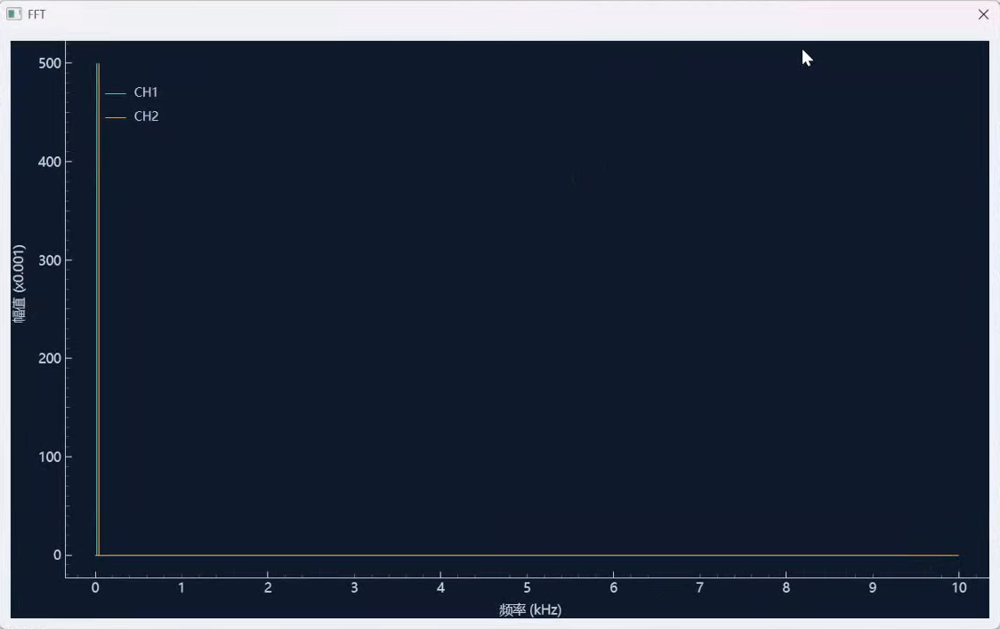

### 导出 CSV / MAT

1. 选择记录文件，设置起止时间，并在左侧勾选要导出的通道。
2. 点击“**导出 CSV…**”或“**导出 MAT…**”，选择文件名与保存位置，等待导出完成提示。

导出使用未抽稀的数据，并采用录制时保存的通道换算参数。CSV 适合表格工具查看，同时生成 `.metadata.json` 元数据文件；MAT 包含时间、数据、有效标记、采样率、通道名称与单位，适合在 MATLAB 中继续分析。较大的 MAT 导出会自动拆分为多个文件。

### 用 MATLAB 打开

1. 安装 MATLAB 后，在“记录分析”中选择记录文件、时间区间和通道，点击右上角“**用 MATLAB 打开**”。无需先手动导出 MAT。
2. 等待 MATLAB 启动并导入数据。有 Simulink 时会打开“**仿真数据检查器**”；仅安装 MATLAB 时使用普通绘图窗口。
3. 在仿真数据检查器左侧勾选信号，用顶部工具栏切换绘图布局、缩放或平移，查看局部波形。可将多路信号叠加比较，也可分配到不同子图。

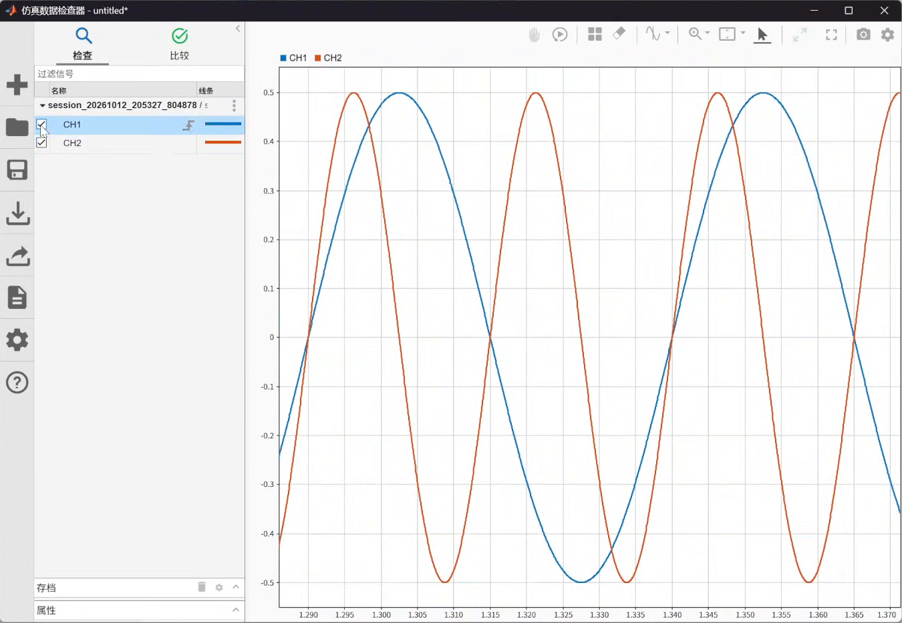

若加载或 MATLAB 打开时提示所选数据过大，缩小时间区间后重试；需要保存较长记录时可使用 MAT 导出。

## 6. 常见错误及参考解决方案

### 点击连接后没有任何数据，软件底部帧计数不增加

1. 检查开发板USB是否连接电脑，是否选择了正确的串口号
2. 检查波特率配置，上位机设置是否和目标模型一致

### 帧同步计数增加

官方的 SCI_TX 模块会根据设置，在发送数据过程中，将固定数量的一组采样数据作为一帧，在一帧开始和结束时附加发送帧头和帧尾(默认配置帧头内容为SSSS，帧尾为EEEE)，以便于上位机的校验和同步

帧同步计数指的是上位机接收的一帧中(帧头与帧尾之间)实际采样组数与接收协议配置中的每帧采样组数不相等，上位机为保证数据完整性和一致性选择丢弃整个帧，计数值在软件底部状态栏显示，常见于数据丢包，协议配置错误。

1. 点击连接后，帧同步快速增加，示波器窗口无数据，此时优先检查协议配置中 "每帧采样组数" 是否和目标模型中的 SCI_TX 模块参数一致(官方默认为600)。
2. 运行过程中帧同步计数缓慢增加，示波器能显示数据。此现象大概率为开发板上传串口通信带宽不足，一帧中的部分采样数据丢失。建议适当减少目标模型同时上传的数据通道数，或降低数据的发送频率。
